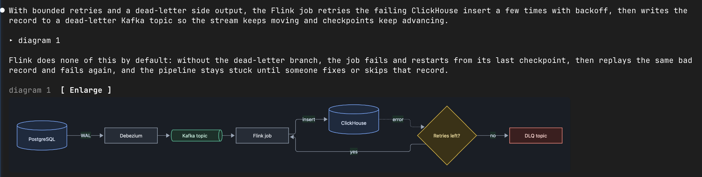
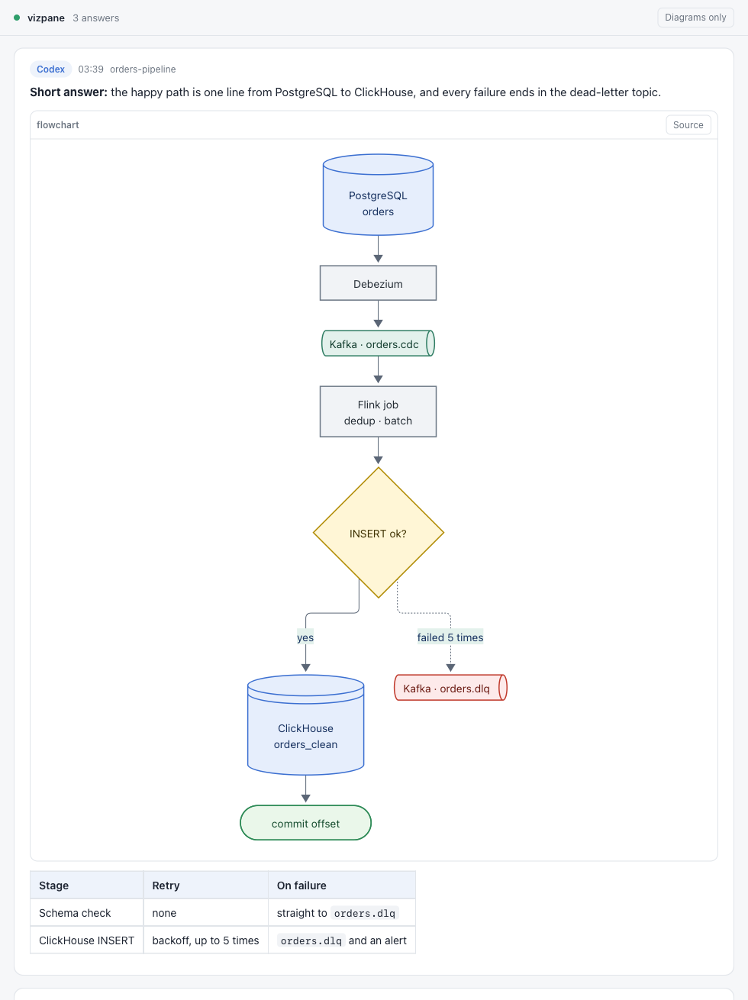
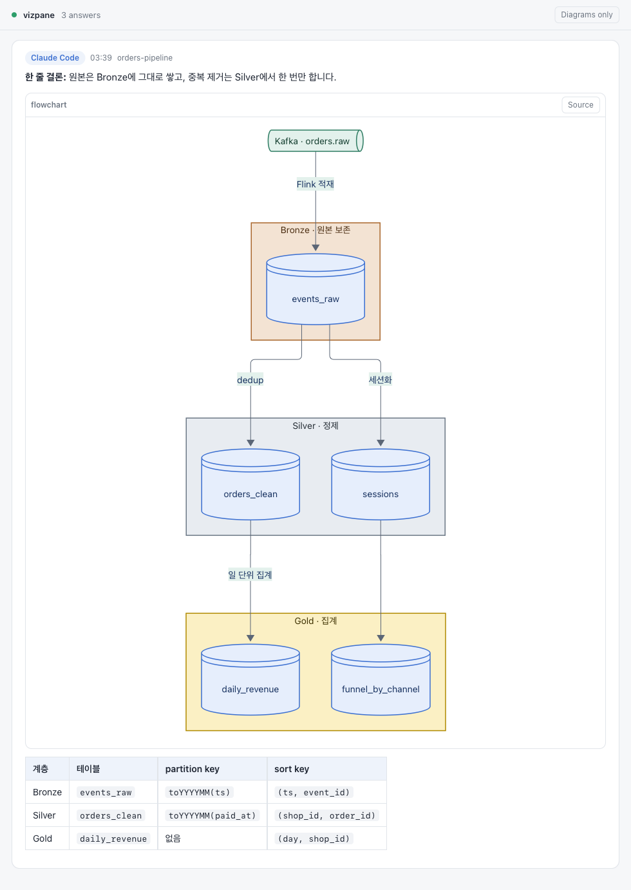
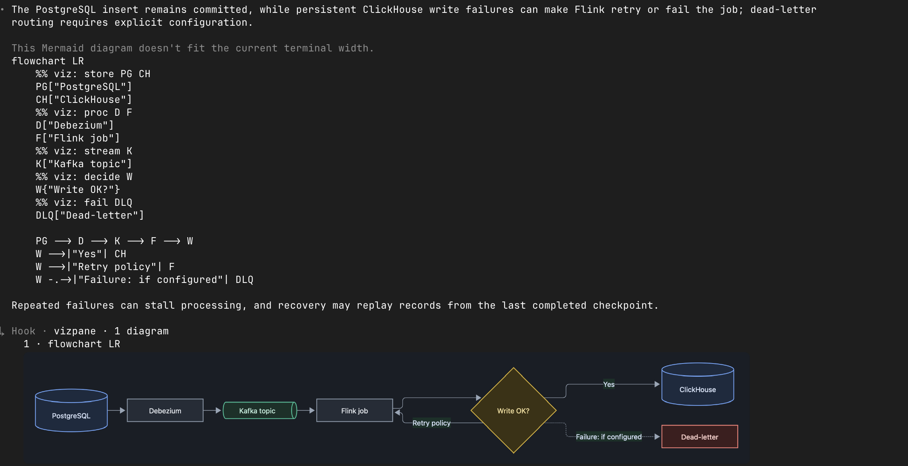

# vizpane

**Claude Code와 Codex의 답변에 든 Mermaid 도식을 그림으로 보여 줍니다. Claude Code는 대화 안에 그립니다. Codex도 opt-in으로 켜는 experimental relay를 쓰면 대화 안에 그리고, 켜지 않으면 cmux 옆 화면에 보여 줍니다.**

[English](README.md)

터미널에서 쓰는 코딩 에이전트는 Mermaid를 코드 그대로 출력합니다. vizpane은 그 도식을 그림으로 그려 줍니다.

- **Claude Code:** 답변 바로 아래, 대화 안에 그림이 나타나고 코드 블록은 한 줄로 접힙니다. Claude Code mod를 쓰며, cmux 같은 Ghostty 계열 터미널과 kitty에서 동작합니다.
- **Codex:** 기본은 turn이 끝나는 순간 같은 답변을 [cmux](https://cmux.com) 안의 browser 화면에 도식이 그려진 상태로 보여 주는 방식입니다. Codex에는 대화 안에 그림을 넣는 extension point가 없어서, vizpane은 Codex를 terminal relay를 거쳐 실행해 Codex가 자기 transcript에 그림을 그리게 할 수도 있습니다. 이 방식은 opt-in이고 experimental입니다. [대화 안에 그림 넣기 (experimental)](#대화-안에-그림-넣기-experimental)를 참고하세요.

서버도 daemon도 없고, 에이전트가 따로 도구를 호출할 필요도 없습니다.



**크게 보기**(영어 환경에서는 Enlarge)를 누르면 옆 화면에 도식이 크게 열립니다.

## 하는 일

| | |
|---|---|
| **자동 표시** | Claude Code는 ` ```mermaid ` 블록을 답변 아래에 그립니다. Codex는 이런 블록이 있는 답변을 turn이 끝날 때 화면에 올립니다. inline relay를 켰다면 대신 답변 아래에 그립니다. 도식이 없는 답변은 올라오지 않고, 요청하면 화면에 올릴 수 있습니다. |
| **단순한 Mermaid에서 풍부한 그림** | 에이전트는 Mermaid의 작고 안전한 일부만 쓰고, 모양·색·묶음은 `%% viz:` 주석 줄에 적습니다. 화면이 이를 원통(저장소), queue(topic), 계층 상자, 구간 색칠, 단계 번호로 바꿔 그립니다. |
| **화면은 한 타임라인** | Codex 답변과 `push`로 보낸 내용이 cmux workspace마다 하나의 화면에 badge로 구분되어 쌓입니다. |
| **답변을 신뢰하지 않음** | 답변에는 웹에서 가져온 글이 섞일 수 있습니다. HTML을 걸러 내고, script는 실행하지 않으며, 원격 이미지와 stylesheet를 제거합니다. |
| **잘 깨지지 않음** | 문법 오류가 있는 도식은 오류 문구와 원본을 보여 주고, 답변의 나머지는 그대로 그립니다. 화면을 닫아도 다음 도식 때 이전 답변과 함께 다시 열립니다. |
| **로컬 전용** | 파일은 `~/.local/state/vizpane` 아래에 본인만 읽을 수 있게 저장됩니다. 네트워크 요청이 없습니다. |

## 단순한 Mermaid가 그림으로

에이전트가 이렇게 쓰면:

````markdown

````

그림은 이렇게 나옵니다. Codex에서는 옆 화면에, Claude Code에서는 답변 아래에 그려집니다.

<picture>
  <source media="(prefers-color-scheme: dark)" srcset="docs/images/flow-dark.png">
  
</picture>

주석은 일반 Mermaid 주석이라 다른 곳에서도 도식이 그대로 유효합니다. 전체 목록은 [docs/diagram-comments.md](docs/diagram-comments.md)(영문)에 있습니다.

계층 상자와 한글 라벨도 같은 방식으로 그려집니다.

<picture>
  <source media="(prefers-color-scheme: dark)" srcset="docs/images/medallion-dark.png">
  
</picture>

한국어로 답하는 에이전트에게는 용어 규칙도 함께 들어갑니다. offset, checkpoint, backpressure처럼 영어 원어로 통하는 말은 번역하지 않고, 적재·장애·재처리·모니터링처럼 한국어로 굳은 말은 그대로 쓰며, 역압력·논리 디코딩 같은 직역은 쓰지 않습니다.

## 필요한 것

- macOS와 [cmux](https://cmux.com) (0.64에서 확인)
- Node.js 20 이상
- Claude Code 또는 Codex CLI
- Claude Code 대화 안에 그림을 그리려면 Claude Code 2.1.290 이상, 이미지를 표시하는 터미널(Ghostty, cmux, kitty), Xcode Command Line Tools(`xcode-select --install`)가 필요합니다. 도구에 든 `swiftc`가 renderer를 한 번, 몇 초 안에 빌드합니다. 없으면 Claude Code는 예전처럼 동작하고 도식은 옆 화면으로 갑니다.
- Codex 대화 안에 그림을 그리려면(experimental) 같은 도구가 필요하고, 도구에 든 `cc`가 relay를 빌드합니다. Codex는 cmux 안에서 실행해야 합니다. [대화 안에 그림 넣기 (experimental)](#대화-안에-그림-넣기-experimental)를 참고하세요.

## 설치

### Claude Code

```bash
claude plugin marketplace add ahwlsqja/vizpane
claude plugin install vizpane@vizpane
```

cmux 안에서 새 세션을 시작합니다. 세션이 시작될 때 plugin이 에이전트에게 도식 작성 규칙을 알려 주고, 설치나 업데이트 뒤 첫 시작에서 renderer를 빌드합니다.

### Codex

```bash
codex plugin marketplace add ahwlsqja/vizpane
codex plugin add vizpane@vizpane
```

그다음 두 가지를 한 번씩 합니다.

1. Codex에서 `/hooks`를 열어 vizpane의 `Stop` hook을 승인합니다.
2. 도식 작성 규칙을 `~/.codex/AGENTS.md`에 붙여 넣습니다. 붙여 넣을 내용은 [docs/codex-setup.md](docs/codex-setup.md)에 있습니다.

Codex 세션을 새로 시작하거나, 기존 세션을 `codex resume <session id>`로 이어서 엽니다. vizpane을 설치할 때 이미 떠 있던 세션에는 hook이 없습니다. [이미 떠 있던 세션](docs/codex-setup.md#sessions-that-were-already-running)을 참고하세요.

#### 대화 안에 그림 넣기 (experimental)



세 번째 단계는 하지 않아도 됩니다. 기본으로는 도식이 있는 Codex 답변이 옆 화면에 열립니다. 그림을 Codex 대화 안에 그리려면 한 번만 이 명령을 실행합니다.

```bash
node ~/.local/state/vizpane/bin/vizpane.mjs codex-inline
```

Xcode Command Line Tools(`swiftc`, `cc`)로 renderer와 relay를 빌드하고, relay가 실행할 Codex를 확인한 뒤 다음과 같은 줄 하나를 출력합니다.

```bash
export CMUX_CUSTOM_CODEX_PATH="$HOME/.local/state/vizpane/relay/codex"
```

이 줄을 shell profile에 직접 추가하고 새 cmux pane을 엽니다. vizpane은 dotfile을 고치지 않습니다. `CMUX_CUSTOM_CODEX_PATH`가 이미 직접 쓰는 Codex를 가리키고 있었다면 그 값을 `VIZPANE_REAL_CODEX`로도 export하세요(명령이 경고해 줍니다). 명령은 그대로 `codex`, `codex resume`입니다. relay는 Codex의 출력만 그대로 전달하고 각 그림의 데이터를 안전한 지점에서 한 번 끼워 넣습니다. 키 입력, terminal mode, 창 크기는 Codex와 shell이 그대로 가지며 relay는 입력을 읽지 않습니다. Ctrl+Z, `fg`, `bg`, `kill %1`은 relay가 없을 때와 같게 동작하도록 설계했고, 알려진 차이가 하나 있습니다(한계 참고). Codex는 답변을 streaming으로 보여 주고, turn이 끝나면 hook이 도식을 render해 그림이 답변 아래에 나타납니다. 그동안 turn 종료가 1초쯤(최대 약 7초) 늦어집니다. `codex resume` 뒤에는 그림이 다시 나오지 않습니다. vizpane을 업데이트한 뒤에는 이 명령을 다시 실행하세요. 그렇지 않으면 답변이 다시 옆 화면으로 갑니다. 현재 build를 cmux 0.64.22와 Codex 0.169.0에서 실제로 실행해 job control(Ctrl+Z, `bg`, `fg`, `kill %1`을 `stty tostop` 유무로 각각)과 도식 turn 하나를 확인했습니다. 그림(여섯 개, 큰 그림 하나), 스트리밍 중 창 크기 변경, Ctrl+G, `codex resume`은 출력 경로가 같은 이전 build에서 실제로 실행해 봤습니다. relay가 기대는 Codex 동작은 0.169.0 source에서 확인했습니다.

relay가 pane의 foreground process이고 cmux 터미널이 출력을 parse하는 방식을 따라가야 하므로 experimental입니다. Codex의 출력 경로에 C 코드 약 2,900줄이 더해지고, Codex 세션마다 process 하나(메모리 약 1.5 MB)가 늘며, 긴 답변을 scroll할 때 core 하나의 약 1.5%를 씁니다. 출력은 relay가 없을 때보다 두세 배 느립니다(약 125 MB/s 대신 40~63 MB/s로, Codex가 내보내는 양보다 훨씬 큽니다). 드물게 clipboard 복사가 실패할 수 있습니다(한계 참고). 켜기 전에 [설정 안내](docs/codex-setup.md#inline-pictures-experimental)(영문)와 [SECURITY.md](SECURITY.md)(영문)를 읽어 보세요. 한 번만 끄려면 `VIZPANE_INLINE=off codex`를 실행하고, 완전히 끄려면 export 줄을 지웁니다.

## 사용

에이전트에게 도식으로 설명해 달라고 하면 됩니다. Claude Code에서는 답변 아래에 그림이 나타나고, 옆의 **크게 보기**를 누르면 옆 화면에 도식이 크게 열립니다. Codex에서는 turn이 끝나면 터미널 오른쪽에 화면이 열리고, 키보드 focus는 옮겨 가지 않습니다. experimental inline relay를 켰다면 그림이 대화 안에 나타납니다.

화면과 아래 명령은 두 에이전트 모두에서 쓸 수 있습니다. 그 밖의 일은 명령 하나로 합니다. 에이전트에게 "화면에 올려 줘"라고 하면 함께 설치되는 `viz` skill이 실행하고, 직접 실행해도 됩니다.

```bash
node ~/.local/state/vizpane/bin/vizpane.mjs <명령>
```

| 명령 | 동작 |
|---|---|
| `push --last` | 직전 답변을 도식 유무와 상관없이 올리기 |
| `push --file notes.md` | 마크다운 파일 올리기 |
| `push --stdin` | 표준 입력으로 받은 마크다운 올리기 |
| `push ... --zoom` | 첫 도식을 크게 연 상태로 올리기 |
| `open` | 화면 열기 |
| `off` / `on` | 이 cmux workspace의 자동 표시 끄기·켜기 |
| `doctor` | 설치 상태 점검 |

화면에서 도식을 클릭하면 크게 보이고, **원본**으로 Mermaid 코드를, **도식만**으로 본문을 접은 모습을 볼 수 있습니다.

### 설정

| 환경 변수 | 동작 |
|---|---|
| `VIZPANE_THEME=light` 또는 `dark` | 시스템 설정 대신 테마 고정. Codex 대화 안 그림은 light가 아니면 dark로 그립니다 |
| `VIZPANE_HOME=/path` | `~/.local/state/vizpane` 대신 다른 곳에 저장 |
| `VIZPANE_INLINE=off` | Claude Code와 Codex 대화 안에 그림을 그리지 않음. 답변은 다시 옆 화면으로 감. Codex는 그 실행에서 relay 없이 시작함 |

## figures plugin과 함께 쓰기

LaTeX 수식, D2, Graphviz, SVG는 [natsukium/claude-code-figures-plugin](https://github.com/natsukium/claude-code-figures-plugin)을 설치해 그립니다. 설정하지 않으면 figures가 내장 renderer로 Mermaid를 그려서 두 plugin이 같은 도식을 각각 그립니다. `renderers` 옵션을 `mmdc`로 두면 figures는 Mermaid에 mermaid-cli만 쓰고, `mmdc`가 설치돼 있지 않은 동안에는 Mermaid 블록을 건너뛰어 vizpane에 맡깁니다.

```bash
echo '{"renderers":"mmdc"}' | claude plugin configure figures@figures --values-stdin
```

## 동작 방식

```text
 agent (TUI)                                       cmux browser pane
+---------------------------+                     +---------------------------+
| Claude Code / Codex       |                     | viewer.html (file://)     |
| answer: markdown + mermaid|                     | marked + DOMPurify        |
+-------------+-------------+                     | + Mermaid 12              |
              | Stop hook                         +-------------^-------------+
              v                                                 |
+---------------------------+   has a mermaid block?            |
| vizpane hook (Node)       |------ yes ---> write turn file ---+
| hands off, exits at once  |                then `cmux browser eval`
+---------------------------+------ no ----> store only
```

이 그림은 relay 없는 Codex와 `push`의 경로입니다. Claude Code에서는 mod가 그림을 그리고 Stop hook은 답변을 저장만 합니다. [docs/how-it-works.md](docs/how-it-works.md#inline-pictures-in-claude-code)(영문)를 참고하세요. Codex relay를 켜면 hook이 도식을 render하고 Codex가 자기 transcript에 그립니다. [docs/how-it-works.md](docs/how-it-works.md#inline-pictures-in-codex-experimental)(영문)를 참고하세요.

이 경로에서 hook은 끝난 답변을 분리된 프로세스에 넘기고 바로 끝나므로 turn을 늦추거나 실패시키지 않습니다. Codex relay를 켜면 위에서 설명한 대로 hook이 먼저 render합니다. 넘겨받은 프로세스가 답변을 저장하고, 도식이 있으면 열려 있는 화면에 불러오게 합니다. 자세한 내용은 [docs/how-it-works.md](docs/how-it-works.md)(영문)에 있습니다.

## 보안

답변은 신뢰할 수 없는 입력으로 다룹니다. inline renderer는 네트워크 로드를 막은 offscreen WebKit view에서 도식을 그립니다. 화면은 DOMPurify로 HTML을 거르고, Mermaid를 strict 보안 수준으로 돌리고, 그려진 SVG에서 원격 이미지와 외부 참조를 제거하며, 링크를 따라가지 않습니다. 저장 파일은 소유자만 읽을 수 있습니다. 위협 모델과 신고 방법은 [SECURITY.md](SECURITY.md)에 있습니다.

## 한계

- **옆 화면은 cmux가 필요합니다.** 화면이 cmux browser 표면입니다. cmux 밖에서는 Codex 답변을 저장만 하고 아무것도 열지 않습니다.
- **Claude Code에는 그림용 extension point가 있고 Codex에는 없습니다.** Claude Code에서는 mod가 그림을 그립니다. Codex에는 그런 지점이 없어서, vizpane은 opt-in했을 때만 terminal relay로 Codex를 감쌉니다. 켜지 않으면 Codex 그림은 옆 화면에 남습니다.
- **Codex 대화 안의 그림은 experimental이고 macOS와 cmux에서만 됩니다.** `codex-inline`이 만드는 relay, shell profile의 export 줄, Xcode Command Line Tools의 `swiftc`와 `cc`가 필요합니다. relay가 죽으면 prompt가 바로 돌아오지만 터미널은 복원되지 않으므로 `reset`을 입력합니다. Codex는 출력을 다음에 쓰거나 터미널을 다음에 읽을 때 끝날 것으로 봅니다(Codex source와 stand-in으로 추론한 것이고 실제 Codex로 재지는 않았습니다. idle 상태인 Codex는 남아 있을 수 있으니 남은 것은 `kill`로 끝내세요). `codex resume`으로 세션을 이어 갈 수 있습니다.
- **Codex 대화 안의 그림은 보존되지 않습니다.** `codex resume` 뒤에는 다시 나오지 않고, Codex가 끝나면 해제됩니다(best effort이며, no-alt-screen 모드에서는 scrollback에 빈 칸이 남습니다). 답변 아래 그림을 render하는 동안 diagram turn 종료가 1초쯤(최대 약 7초) 늦어집니다.
- **`stty tostop`을 켠 상태에서 `bg`, `fg`를 하면 Codex가 raw mode 없이 돌아옵니다.** shell에 `stty tostop`을 설정한 경우(macOS 기본값은 아닙니다) Ctrl+Z, `bg`, `fg`를 거치면 relay를 쓰는 Codex가 raw mode 없이 돌아옵니다. 입력이 줄 단위로 모이고, `/quit` 뒤 첫 Enter가 줄바꿈으로 들어갑니다. stock Codex도 `tostop`이 꺼져 있으면 똑같이 됩니다. resume 뒤에 중단된 `tcsetattr`를 다시 시도하지 않기 때문입니다. relay가 있으면 Codex의 출력이 controlling terminal이 아니라서 `tostop`이 켜져 있어도 같은 일이 생깁니다. `/quit`을 입력하고 Enter를 두 번 누른 뒤 `codex resume`으로 이어 가세요. upstream에 [openai/codex#37088](https://github.com/openai/codex/issues/37088)로 제보했습니다. `bg` 없이 Ctrl+Z와 `fg`만 쓰면 영향이 없을 것입니다. `fg`가 raw mode 설정보다 먼저 Codex를 foreground로 돌려놓기 때문입니다(소스로 확인했고 시험하지는 않았습니다).
- **Codex의 native clipboard가 실패하면 `/copy`가 실패할 수 있습니다.** Codex는 macOS clipboard로 복사하고, 그것이 실패할 때만 OSC 52 sequence를 씁니다. relay가 있으면 이 sequence가 Codex 자신의 화면 글자에 잘릴 수 있습니다. 1 KiB 복사는 약 11%~77%, 4 KiB는 60%~98%가 잘리고, 300 byte 이하는 잘린 적이 없습니다(잘리는 비율이며, Codex의 write 패턴으로 잰 값입니다. `test/relay-osc52.test.mjs`가 출력합니다). 잘린 복사는 cmux 터미널이 올바른 base64가 아니라며 거의 항상 거부하므로 clipboard는 이전 내용 그대로이고, Codex는 "Copy unconfirmed"라고 알려 줍니다. 이 메시지가 보이면 shell에 붙여 넣기 전에 clipboard를 확인하세요. 이전에 복사한 내용이 들어 있을 수 있습니다. 잘린 복사 중 일부(한 번 측정에서 603건 중 21건)는 앞부분만 복사된 채 남을 수 있습니다. [SECURITY.md](SECURITY.md)(영문)를 참고하세요.
- **Claude Code 대화 안의 그림은 macOS, `swiftc`, 이미지를 표시하는 터미널이 필요합니다.** 없으면 Claude Code는 코드 블록을 그대로 보여 주고 답변은 옆 화면으로 갑니다.
- **대화 안의 그림은 도식만 지원합니다.** renderer는 Mermaid만 그립니다.
- **cmux workspace마다 화면은 하나입니다.** 그 workspace의 모든 에이전트가 같이 씁니다.
- **Mermaid 버전은 고정입니다.** `plugins/vizpane/viewer/vendor/VERSIONS.json`에 적힌 버전을 씁니다.
- **에이전트가 도식 규칙을 항상 지키지는 않습니다.** 규칙은 지시문입니다. 규칙을 어긴 도식도 일반 Mermaid로는 그려집니다.
- **넓은 도식은 가로로 스크롤됩니다.** 시퀀스 다이어그램은 참가자 5명 이하를 권합니다. 가이드도 에이전트에게 같은 기준을 알려 줍니다.

## 개발

```bash
node --test                           # 단위·계약 테스트, cmux 불필요
node scripts/e2e-cmux.mjs             # end-to-end, cmux 터미널 안에서 실행
npm run check:codex-inline            # Codex relay 화면 확인, 비어 있는 cmux pane에서만 실행
node scripts/vendor.mjs               # 번들한 browser 라이브러리 갱신
```

[CONTRIBUTING.md](CONTRIBUTING.md)를 참고하세요.

## 라이선스

[MIT](LICENSE). 화면은 Mermaid, marked, DOMPurify를 번들합니다. 각 라이선스는 [THIRD_PARTY_NOTICES.md](THIRD_PARTY_NOTICES.md)에 있습니다.
