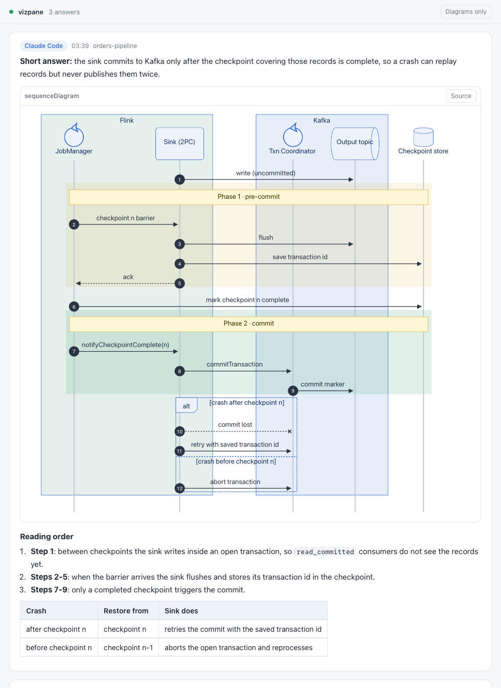
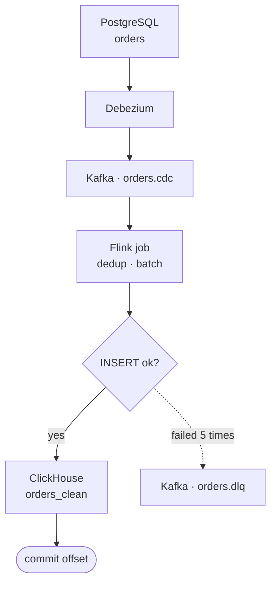

# vizpane

**Claude Code와 Codex의 답변에 든 Mermaid 도식을, cmux 옆 화면에 그림으로 보여 줍니다.**

[English](README.md)

터미널에서 쓰는 코딩 에이전트는 Mermaid를 코드 그대로 출력합니다. vizpane은 에이전트의 turn이 끝나는 순간 같은 답변을 [cmux](https://cmux.com) 안의 browser 화면에 도식이 그려진 상태로 보여 줍니다. 서버도 daemon도 없고, 에이전트가 따로 도구를 호출할 필요도 없습니다.

<picture>
  <source media="(prefers-color-scheme: dark)" srcset="docs/images/sequence-dark.png">
  
</picture>

## 하는 일

| | |
|---|---|
| **자동 표시** | 답변에 ` ```mermaid ` 블록이 있으면 turn이 끝날 때 화면에 올라옵니다. 도식이 없는 답변은 올라오지 않고, 요청하면 올릴 수 있습니다. |
| **단순한 Mermaid에서 풍부한 그림** | 에이전트는 Mermaid의 작고 안전한 일부만 쓰고, 모양·색·묶음은 `%% viz:` 주석 줄에 적습니다. 화면이 이를 원통(저장소), queue(topic), 계층 상자, 구간 색칠, 단계 번호로 바꿔 그립니다. |
| **두 에이전트가 한 타임라인** | 같은 cmux workspace의 Claude Code와 Codex 답변이 한 화면에 badge로 구분되어 쌓입니다. |
| **답변을 신뢰하지 않음** | 답변에는 웹에서 가져온 글이 섞일 수 있습니다. HTML을 걸러 내고, script는 실행하지 않으며, 원격 이미지와 stylesheet를 제거합니다. |
| **잘 깨지지 않음** | 문법 오류가 있는 도식은 오류 문구와 원본을 보여 주고, 답변의 나머지는 그대로 그립니다. 화면을 닫아도 다음 도식 때 이전 답변과 함께 다시 열립니다. |
| **로컬 전용** | 파일은 `~/.local/state/vizpane` 아래에 본인만 읽을 수 있게 저장됩니다. 네트워크 요청이 없습니다. |

## 단순한 Mermaid가 그림으로

에이전트가 이렇게 쓰면:

````markdown

````

화면에는 이렇게 나옵니다.

<picture>
  <source media="(prefers-color-scheme: dark)" srcset="docs/images/flow-dark.png">
  
</picture>

주석은 일반 Mermaid 주석이라 다른 곳에서도 도식이 그대로 유효합니다. 전체 목록은 [docs/diagram-comments.md](docs/diagram-comments.md)(영문)에 있습니다.

계층 상자와 한글 라벨도 같은 방식으로 그려집니다.

<picture>
  <source media="(prefers-color-scheme: dark)" srcset="docs/images/medallion-dark.png">
  
</picture>

한국어로 답하는 에이전트에게는 용어 규칙도 함께 들어갑니다. offset, checkpoint, backpressure처럼 영어 원어로 통하는 말은 번역하지 않고, 적재·장애·재처리·모니터링처럼 한국어로 굳은 말은 그대로 쓰며, 역압력·논리 디코딩 같은 직역은 쓰지 않습니다.

## 필요한 것

- macOS와 [cmux](https://cmux.com) (0.64에서 확인)
- Node.js 20 이상
- Claude Code 또는 Codex CLI

## 설치

### Claude Code

```bash
claude plugin marketplace add ahwlsqja/vizpane
claude plugin install vizpane@vizpane
```

cmux 안에서 새 세션을 시작합니다. 세션이 시작될 때 plugin이 에이전트에게 도식 작성 규칙을 알려 줍니다.

### Codex

```bash
codex plugin marketplace add ahwlsqja/vizpane
codex plugin add vizpane@vizpane
```

그다음 두 가지를 한 번씩 합니다.

1. Codex에서 `/hooks`를 열어 vizpane의 `Stop` hook을 승인합니다.
2. 도식 작성 규칙을 `~/.codex/AGENTS.md`에 붙여 넣습니다. 붙여 넣을 내용은 [docs/codex-setup.md](docs/codex-setup.md)에 있습니다.

Codex 세션을 새로 시작하거나, 기존 세션을 `codex resume <session id>`로 이어서 엽니다. vizpane을 설치할 때 이미 떠 있던 세션에는 hook이 없습니다. [이미 떠 있던 세션](docs/codex-setup.md#sessions-that-were-already-running)을 참고하세요.

## 사용

에이전트에게 도식으로 설명해 달라고 하면 됩니다. turn이 끝나면 터미널 오른쪽에 화면이 열리고, 키보드 focus는 옮겨 가지 않습니다.

그 밖의 일은 명령 하나로 합니다. 에이전트에게 "화면에 올려 줘"라고 하면 함께 설치되는 `viz` skill이 실행하고, 직접 실행해도 됩니다.

```bash
node ~/.local/state/vizpane/bin/vizpane.mjs <명령>
```

| 명령 | 동작 |
|---|---|
| `push --last` | 직전 답변을 도식 유무와 상관없이 올리기 |
| `push --file notes.md` | 마크다운 파일 올리기 |
| `push --stdin` | 표준 입력으로 받은 마크다운 올리기 |
| `open` | 화면 열기 |
| `off` / `on` | 이 cmux workspace의 자동 표시 끄기·켜기 |
| `doctor` | 설치 상태 점검 |

화면에서 도식을 클릭하면 크게 보이고, **원본**으로 Mermaid 코드를, **도식만**으로 본문을 접은 모습을 볼 수 있습니다.

### 설정

| 환경 변수 | 동작 |
|---|---|
| `VIZPANE_THEME=light` 또는 `dark` | 시스템 설정 대신 테마 고정 |
| `VIZPANE_HOME=/path` | `~/.local/state/vizpane` 대신 다른 곳에 저장 |

## 동작 방식

```text
 agent (TUI)                                       cmux browser pane
+---------------------------+                     +---------------------------+
| Claude Code / Codex       |                     | viewer.html (file://)     |
| answer: markdown + mermaid|                     | marked + DOMPurify        |
+-------------+-------------+                     | + Mermaid 12              |
              | Stop hook                         +-------------^-------------+
              v                                                 |
+---------------------------+   has a mermaid block?            |
| vizpane hook (Node)       |------ yes ---> write turn file ---+
| hands off, exits at once  |                then `cmux browser eval`
+---------------------------+------ no ----> store only
```

hook은 끝난 답변을 분리된 프로세스에 넘기고 바로 끝나므로 turn을 늦추거나 실패시키지 않습니다. 넘겨받은 프로세스가 답변을 저장하고, 도식이 있으면 열려 있는 화면에 불러오게 합니다. 자세한 내용은 [docs/how-it-works.md](docs/how-it-works.md)(영문)에 있습니다.

## 보안

답변은 신뢰할 수 없는 입력으로 다룹니다. 화면은 DOMPurify로 HTML을 거르고, Mermaid를 strict 보안 수준으로 돌리고, 그려진 SVG에서 원격 이미지와 외부 참조를 제거하며, 링크를 따라가지 않습니다. 저장 파일은 소유자만 읽을 수 있습니다. 위협 모델과 신고 방법은 [SECURITY.md](SECURITY.md)에 있습니다.

## 한계

- **cmux 전용입니다.** 화면이 cmux browser 표면입니다. cmux 밖에서는 저장만 하고 아무것도 열지 않습니다.
- **그림은 대화 안이 아니라 옆에 뜹니다.** Claude Code와 Codex가 터미널 화면을 직접 그리기 때문에 밖에서 그 안에 그림을 넣을 수 없습니다.
- **cmux workspace마다 화면은 하나입니다.** 그 workspace의 모든 에이전트가 같이 씁니다.
- **Mermaid 버전은 고정입니다.** `plugins/vizpane/viewer/vendor/VERSIONS.json`에 적힌 버전을 씁니다.
- **에이전트가 도식 규칙을 항상 지키지는 않습니다.** 규칙은 지시문입니다. 규칙을 어긴 도식도 일반 Mermaid로는 그려집니다.
- **넓은 도식은 가로로 스크롤됩니다.** 시퀀스 다이어그램은 참가자 5명 이하를 권합니다. 가이드도 에이전트에게 같은 기준을 알려 줍니다.

## 개발

```bash
node --test                           # 단위·계약 테스트, cmux 불필요
node scripts/e2e-cmux.mjs             # end-to-end, cmux 터미널 안에서 실행
node scripts/vendor.mjs               # 번들한 browser 라이브러리 갱신
```

[CONTRIBUTING.md](CONTRIBUTING.md)를 참고하세요.

## 라이선스

[MIT](LICENSE). 화면은 Mermaid, marked, DOMPurify를 번들합니다. 각 라이선스는 [THIRD_PARTY_NOTICES.md](THIRD_PARTY_NOTICES.md)에 있습니다.
