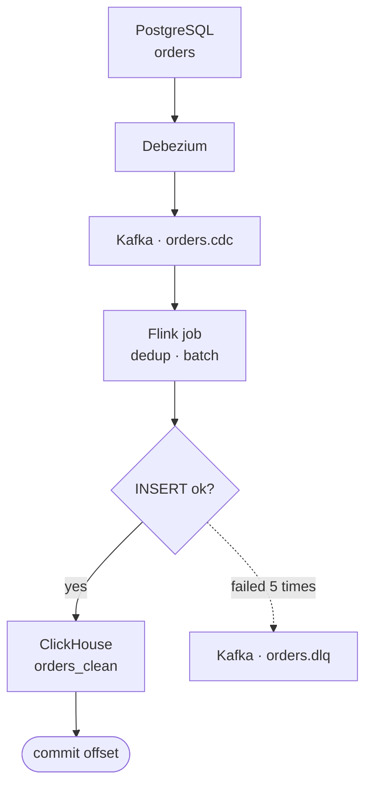

# vizpane

**Rendered Mermaid diagrams for Claude Code and Codex, in a cmux pane next to the agent.**

[](https://github.com/ahwlsqja/vizpane/actions/workflows/test.yml)
[](LICENSE)
[](https://cmux.com)

[한국어](README.ko.md)

Terminal coding agents print Mermaid as source code. vizpane shows the same answer with the diagram drawn, in a browser pane inside [cmux](https://cmux.com), the moment the agent finishes its turn. There is no server, no daemon and no tool call for the agent to make.

<picture>
  <source media="(prefers-color-scheme: dark)" srcset="docs/images/sequence-dark.png">
  
</picture>

## What it does

| | |
|---|---|
| **Automatic** | An answer that contains a ` ```mermaid ` block appears in the pane when the turn ends. Answers without a diagram stay out of the way, and you can show one on request. |
| **Rich pictures from plain Mermaid** | Agents write a small, safe subset of Mermaid and describe shapes, colours and grouping in `%% viz:` comment lines. The viewer turns those into cylinders for stores, queues for topics, layer boxes, shaded phases and numbered steps. |
| **One timeline for both agents** | Claude Code and Codex answers from the same cmux workspace land in one pane, each with its own badge. |
| **Untrusted by default** | Answers can contain text fetched from the web. HTML is sanitised, scripts never run, and remote images and stylesheets are removed. |
| **Hard to break** | A diagram with a syntax error shows the error and its source while the rest of the answer renders. Close the pane and the next diagram reopens it with earlier answers restored. |
| **Local** | Files under `~/.local/state/vizpane`, readable only by you. No network requests. |

## Plain Mermaid in, picture out

The agent writes this:

````markdown

````

and the pane shows this:

<picture>
  <source media="(prefers-color-scheme: dark)" srcset="docs/images/flow-dark.png">
  
</picture>

The comments are ordinary Mermaid comments, so the diagram stays valid everywhere else. The full list is in [docs/diagram-comments.md](docs/diagram-comments.md).

Layers and CJK labels work the same way:

<picture>
  <source media="(prefers-color-scheme: dark)" srcset="docs/images/medallion-dark.png">
  
</picture>

## Requirements

- macOS with [cmux](https://cmux.com) (tested with 0.64)
- Node.js 20 or later
- Claude Code, Codex CLI, or both

## Install

### Claude Code

```bash
claude plugin marketplace add ahwlsqja/vizpane
claude plugin install vizpane@vizpane
```

Start a new session inside cmux. The plugin tells the agent how to write diagrams at session start.

### Codex

```bash
codex plugin marketplace add ahwlsqja/vizpane
codex plugin add vizpane@vizpane
```

Then do two things once:

1. Open `/hooks` in Codex and approve the vizpane `Stop` hook.
2. Paste the diagram rules into `~/.codex/AGENTS.md`. The block is in [docs/codex-setup.md](docs/codex-setup.md).

## Use

Ask the agent to explain something with a diagram. When the turn ends, the pane opens to the right of the terminal without taking keyboard focus.

Everything else goes through one command. Ask the agent ("show that in the pane") and the bundled `viz` skill runs it, or run it yourself:

```bash
node ~/.local/state/vizpane/bin/vizpane.mjs <command>
```

| Command | Effect |
|---|---|
| `push --last` | Show the last answer, with or without a diagram |
| `push --file notes.md` | Show a Markdown file |
| `open` | Open the pane |
| `off` / `on` | Turn automatic display off or on for this cmux workspace |
| `doctor` | Check the installation |

In the pane, click a diagram to enlarge it, use **Source** to see the Mermaid text, and **Diagrams only** to hide the prose.

### Settings

| Environment variable | Effect |
|---|---|
| `VIZPANE_THEME=light` or `dark` | Force a theme instead of following the system |
| `VIZPANE_HOME=/path` | Keep state somewhere other than `~/.local/state/vizpane` |

## How it works

```text
 agent (TUI)                                       cmux browser pane
+---------------------------+                     +---------------------------+
| Claude Code / Codex       |                     | viewer.html (file://)     |
| answer: markdown + mermaid|                     | marked + DOMPurify        |
+-------------+-------------+                     | + Mermaid 12              |
              | Stop hook                         +-------------^-------------+
              v                                                 |
+---------------------------+   has a mermaid block?            |
| vizpane hook (Node)       |------ yes ---> write turn file ---+
| hands off, exits at once  |                then `cmux browser eval`
+---------------------------+------ no ----> store only
```

The hook passes the finished answer to a detached worker and returns immediately, so it never delays or fails a turn. The worker stores the answer, and if it contains a diagram, tells the open viewer page to load it. Details are in [docs/how-it-works.md](docs/how-it-works.md).

## Security

Answers are treated as untrusted input. The viewer sanitises HTML with DOMPurify, runs Mermaid at its strict security level, strips remote images and external references from rendered SVG, and never follows links. State is stored with owner-only permissions. See [SECURITY.md](SECURITY.md) for the threat model and how to report a problem.

## Limitations

- **cmux only.** The pane is a cmux browser surface. Outside cmux, answers are stored and nothing opens.
- **The picture is beside the conversation, not inside it.** Claude Code and Codex draw their own terminal screen, and nothing outside them can place an image in it.
- **One pane per cmux workspace.** Every agent in the workspace shares it.
- **Mermaid is pinned** to the version in `plugins/vizpane/viewer/vendor/VERSIONS.json`.
- **Agents follow the diagram rules most of the time, not always.** The rules are instructions. A diagram that ignores them still renders as ordinary Mermaid.
- **Wide diagrams scroll.** Keep sequence diagrams to five participants; the guide tells agents the same.

## Development

```bash
node --test                           # unit and contract tests, no cmux needed
node scripts/e2e-cmux.mjs             # end-to-end, run inside a cmux terminal
node scripts/vendor.mjs               # refresh the vendored browser libraries
```

See [CONTRIBUTING.md](CONTRIBUTING.md).

## License

[MIT](LICENSE). The viewer bundles Mermaid, marked and DOMPurify; their licences are in [THIRD_PARTY_NOTICES.md](THIRD_PARTY_NOTICES.md).
