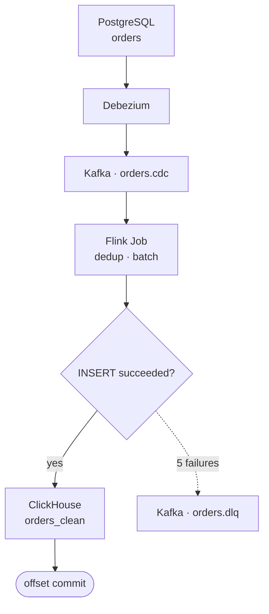
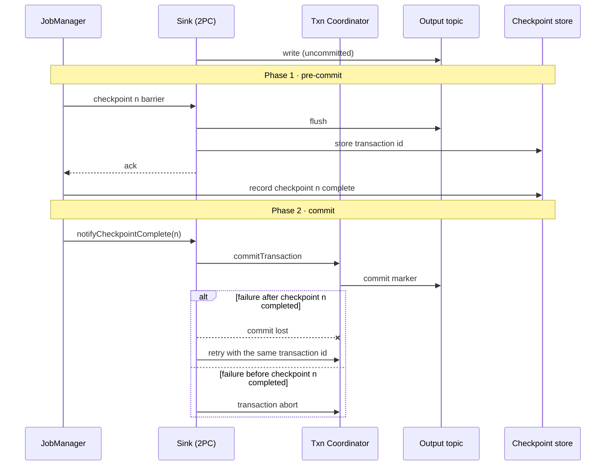
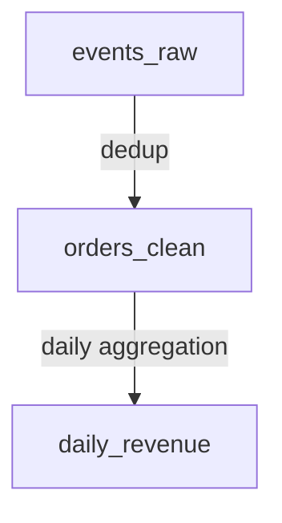

# Writing diagrams for vizpane

vizpane renders Mermaid code blocks in an answer. This page is the reference for how agents are asked to write them: a small plain subset of Mermaid for structure, plus `%% viz:` comment lines for shape, colour and grouping.

The same rules are given to the agent by the `viz-style` skill and by the session context. This page is the English reference for the behaviour of the viewer.

## Why comments

A `%% viz:` line is a Mermaid comment. Without vizpane it is ignored, so the diagram stays valid Mermaid anywhere. In the viewer, `upgradeSource` reads the comment lines and rewrites the diagram into Mermaid syntax that carries the shapes, colours and groups. Keeping the body plain lowers the chance of a syntax error and keeps the diagram readable as text.

The Codex TUI has a built-in text renderer for Mermaid that accepts the plain subset. It draws the diagram in the terminal when the width allows. This is a side benefit of the plain subset, not a goal of vizpane.

## Plain subset

### flowchart

- Direction: `flowchart TB`. Use `LR` only for four nodes or fewer.
- Nodes: `id["label"]` rectangle, `id{"label"}` decision, `id(["label"])` start or end. An id starts with a letter and contains letters, digits and underscores.
- Edges: `-->` normal path, `-.->` failure, asynchronous or secondary path. Edge label: `-->|"label"|`.
- Keep labels short. Break long ones with ` `.
- At most 15 nodes. Split the diagram beyond that.

### sequenceDiagram

- Participants: `participant ID as Label`, `actor ID as Label`. Declare all of them at the top.
- Arrows: `->>` request, `-->>` response, `--x` lost or failed.
- `Note over A,B: text`.
- Blocks: `alt` ... `else` ... `end`, `loop`, `opt`, `critical`, `break`. One `else` per `alt`.
- Message to self: `A->>A: text`.
- At most 5 participants. Keep message text and participant labels short.

### Other diagram types

`erDiagram` and `stateDiagram-v2` take no comments and are used plainly. Draw keys and relations only when they are confirmed by a schema; use flat states and `A --> B: event` transitions.

### Explicit Mermaid still works

The viewer renders any syntax Mermaid 12 accepts, including `subgraph`, `classDef`, `class`, `style`, `:::name`, `box`, `rect`, `autonumber` and `@{ shape: ... }`. The guide asks agents not to use them, because the plain subset plus comments covers the same needs and renders in the Codex terminal. A `classDef` that you define yourself is not overwritten by the viewer.

## `%% viz:` comments

Rules for all comments:

- The comment is a whole line that starts with `%% viz:`. Leading spaces are allowed. A comment placed after other text on a line is not read.
- Arguments are node ids (flowchart) or participant ids (sequence diagram), separated by spaces. Use the declared id, not the label. Tokens that are not valid ids are skipped.
- An unknown verb is ignored. A comment in a diagram type other than flowchart and sequenceDiagram is ignored.
- Position does not matter to the viewer. The guide asks agents to put comments above the node declarations.

### flowchart verbs

| Comment | Meaning | Effect |
|---|---|---|
| `%% viz: stream <id...>` | Kafka topic, queue | Horizontal cylinder, `stream` colour |
| `%% viz: store <id...>` | Database, state store | Cylinder, `store` colour |
| `%% viz: table <id...>` | OLAP table | Cylinder with lines, `store` colour |
| `%% viz: database <id...>` | Alias of `store` | As `store` |
| `%% viz: queue <id...>` | Alias of `stream` | As `stream` |
| `%% viz: proc <id...>` | Job, service, connector | `proc` colour |
| `%% viz: decide <id...>` | Decision | `decide` colour |
| `%% viz: fail <id...>` | Failure path, DLQ, alert | `fail` colour |
| `%% viz: ok <id...>` | Successful end | `ok` colour |
| `%% viz: ext <id...>` | System you do not own | `ext` colour |
| `%% viz: bronze <id...>` | Medallion layer | Boxed in a "Bronze" group, `bronze` colour on the box |
| `%% viz: silver <id...>` | Medallion layer | Same, titled "Silver" |
| `%% viz: gold <id...>` | Medallion layer | Same, titled "Gold" |
| `%% viz: group <id...> as Title` | A real boundary such as a system or owning team | Box with the given title, or "Group 1", "Group 2" ... if no title |

Details:

- One id can have a shape verb and a colour verb: `stream dlq` followed by `fail dlq` gives a horizontal cylinder in the `fail` colour. The first shape given to an id wins; the last colour given wins.
- A layer title is changed with `as`: `%% viz: bronze raw as Bronze - raw data`. Repeated lines for the same layer add ids to the same box.
- Double quotes in a title are turned into single quotes and backslashes are removed.
- The ids of a layer or group are placed inside a Mermaid `subgraph`.

### sequenceDiagram verbs

| Comment | Meaning | Effect |
|---|---|---|
| `%% viz: queue <id...>` | Data that flows, such as a Kafka topic | Queue shape |
| `%% viz: database <id...>` | Database, table, store | Database shape |
| `%% viz: control <id...>` | Job, coordinator, scheduler | Control shape |
| `%% viz: boundary <id...>` | Accepted by the code, not in the guide | Boundary shape |
| `%% viz: entity <id...>` | Accepted by the code, not in the guide | Entity shape |
| `%% viz: collections <id...>` | Accepted by the code, not in the guide | Collections shape |
| `%% viz: box <id...> as Title` | Participants of one system | Tinted box around them, titled with the text after `as` |
| `%% viz: phase` ... `%% viz: end` | A phase of the interaction | Shaded band |

Details:

- A kind applies to `participant` declarations. `actor` declarations are left unchanged.
- The alias is kept: `participant K as Kafka` with `%% viz: queue K` becomes a queue-shaped participant labelled Kafka.
- Label instead of id: if an id is not declared, the viewer tries the first word of a participant label, case-insensitively. `participant K as Kafka broker` with `%% viz: queue Kafka` works. A word shared by two declarations matches nothing, and a declared id always wins. This applies to kind verbs and `box`.
- `box` collects the listed participants into one box at the position of the first participant of the box, so participants of one box end up next to each other. Boxes are tinted in turn from four colours. A participant listed in two boxes belongs to the first.
- `phase` and `end` must alternate strictly, starting with `phase`, and be balanced. If they are not, none of them is applied and the lines stay comments. Phases take four tints in turn. Start a phase with `Note over A,B: Phase 1 - name` and do not let a phase end half-way through an `alt` or `loop` block.
- Step numbers: the viewer inserts `autonumber` after the `sequenceDiagram` line, unless the diagram already has an `autonumber` line or a line that has a number marker such as `1.` or `1)` after a colon. Do not number messages by hand; refer to the automatic numbers in the text.

## Semantic colours

Colours are chosen by the viewer for the current theme. Agents are asked not to write colours.

| Name | Used for | Hue |
|---|---|---|
| `stream` | Topics, queues | Green |
| `store` | Databases, tables | Blue |
| `proc` | Jobs, services | Grey |
| `decide` | Decisions | Yellow |
| `fail` | Failures, DLQ, alerts | Red |
| `ok` | Successful end | Green (lighter than `stream`) |
| `ext` | External systems | Purple |
| `bronze` | Raw layer | Brown |
| `silver` | Refined layer | Grey-blue |
| `gold` | Aggregated layer | Gold |

These names also work as plain classes in a flowchart (`id:::fail`). If the diagram uses one of them and does not define it with `classDef`, the viewer adds a definition. Sequence diagrams do not use these colours.

## Sizing

- One diagram tells one story. Split a diagram that tells two.
- Sequence diagrams: at most 5 participants. The pane is narrow, and more participants make the text small.
- Flowcharts: at most 15 nodes, `flowchart TB`.
- Put long explanations in the text or in a table, not in labels.
- Draw only what has been verified. Do not invent retries, parallelism or relations from names.
- Wrap a label that contains `(`, `)`, `{`, `}` or `:` in double quotes, and do not use `end` as a node id.

## Examples

### Flow

### Sequence

### Medallion layers

