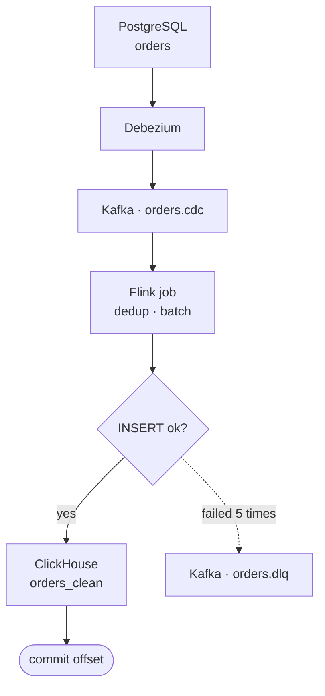
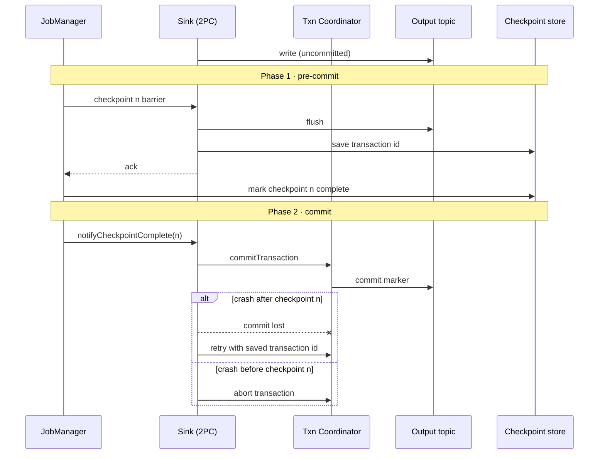
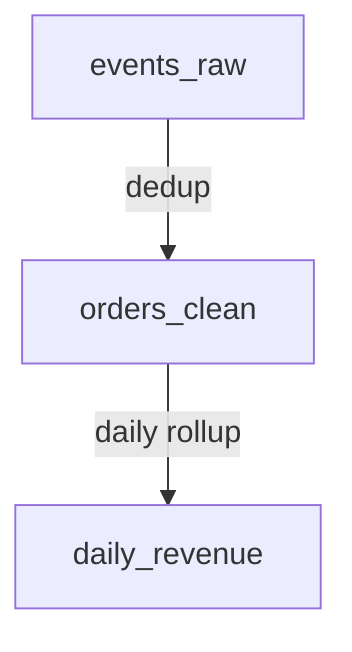

# viz-style: diagrams that render in the side pane

A ` ```mermaid ` block in your answer is rendered as a picture in the side pane (vizpane). The terminal shows the code as text, so write the answer so that it still reads well if the reader skips the diagram.

**Write the diagram body in plain syntax, and put shapes, colours and grouping in `%% viz:` comment lines.** The side pane reads the comments and applies them to the picture.

- Plain syntax produces far fewer Mermaid syntax errors.
- The Codex terminal can also draw this plain syntax as a text diagram when it fits the terminal width. Do not cut content to make it fit.

This skill only governs presentation. Project rules (`AGENTS.md`, `CLAUDE.md`) and fact-checking always come first.

## When to draw

- Draw when there are three or more relationships, branches, boundaries or ordered steps.
- Do not draw for a one-step answer, when a diagram adds nothing, or when the user asked for text only.
- Draw only what you verified. Do not invent parallelism, foreign keys, retries or state transitions from function or field names. Leave unverified parts out of the diagram and say "needs checking" in the text.

## Answer layout

1. One-line conclusion
2. One diagram. One diagram tells one story; two stories need two diagrams.
3. Reading order: 3 to 7 lines. For a sequence diagram the side pane numbers the messages in order, so refer to those step numbers.
4. A table when it helps (comparison, behaviour on failure, list of keys)

## Which diagram

| To explain | Use |
|---|---|
| The path data takes, decisions | `flowchart` |
| Calls and messages between systems, failure branches | `sequenceDiagram` |
| Table structure and keys | `erDiagram` |
| State changes of one thing | `stateDiagram-v2` |

## flowchart: plain syntax

Use only the following.

- Direction: `flowchart TB` by default. `LR` only for four nodes or fewer.
- Nodes: `id["label"]` box, `id{"label"}` decision, `id(["label"])` start or end. An id starts with a letter and contains letters, digits and underscores.
- Arrows: `-->` normal path, `-.->` failure, asynchronous or secondary path. Labels: `-->|"label"|`.
- Keep labels short. Break a long label with `<br/>`.
- At most 15 nodes. Split the diagram if you need more.

Do not use (the comments below replace what you need): `subgraph`, `==>`, `@{ shape: … }`, other shapes such as `[( )]` and `(( ))`, `class`, `classDef`, `style`, `linkStyle`, `:::`, `---` front matter, `%%{init}%%`.

### flowchart comments

Put them above the node declarations. One line can list several ids.

| Comment | Meaning | In the side pane |
|---|---|---|
| `%% viz: stream <id…>` | Kafka topic, queue | horizontal cylinder, green |
| `%% viz: store <id…>` | database, state store | cylinder, blue |
| `%% viz: table <id…>` | OLAP table | lined cylinder, blue |
| `%% viz: proc <id…>` | job, service, connector | grey |
| `%% viz: decide <id…>` | decision | yellow |
| `%% viz: fail <id…>` | failure path, dead-letter queue, alert | red |
| `%% viz: ok <id…>` | successful end | green |
| `%% viz: ext <id…>` | external system you do not own | purple |
| `%% viz: bronze <id…>`, `silver`, `gold` | medallion layer | grouped in a layer box |
| `%% viz: group <id…> as Title` | a real boundary such as a system or owning team | grouped in a box |

- A node can have a shape comment and a colour comment. `stream dlq` plus `fail dlq` gives a red horizontal cylinder.
- To change a layer title, write it after `as`: `%% viz: bronze raw as Bronze · raw data`.

## sequenceDiagram: plain syntax

- Participants: `participant ID as Label`; a person is `actor ID as Label`. Declare all of them at the top.
- Arrows: `->>` request, `-->>` response, `--x` lost or failed.
- `Note over A,B: text`
- Blocks: `alt condition` … `else condition` … `end`, `loop`, `opt`, `critical`, `break`. One `else` per `alt`.
- A message to itself: `A->>A: text`.

Do not use (the comments below replace what you need): `autonumber`, `box`, `rect`, `activate`, `par`, `-)`, `participant X@{ … }`, `create`, `destroy`.

### Size

- At most five participants. Split the diagram if you need more; the side pane is narrow and text gets small.
- Keep each message to one short line. Longer explanations go into the reading order or a table.
- Keep participant labels short: `JobManager`, not `JobManager (Checkpoint Coordinator)`.

### sequenceDiagram comments

| Comment | Meaning | In the side pane |
|---|---|---|
| `%% viz: queue <id…>` | flowing data such as a Kafka topic | queue shape |
| `%% viz: database <id…>` | database, table, store | cylinder shape |
| `%% viz: control <id…>` | job, coordinator, scheduler | control shape |
| `%% viz: box <id…> as Title` | participants of one system | grouped in a coloured box |
| `%% viz: phase` … `%% viz: end` | a phase | the span is shaded |

- Put the kind and `box` comments above the `participant` declarations.
- Make the first line of a phase `Note over A,B: Phase 1 · name`.
- Phases must not overlap, and must not cut through an `alt` or `loop` block.
- The side pane adds step numbers automatically. Do not write `1.` yourself.

## erDiagram, stateDiagram-v2

Write them plainly, without comments.

- `erDiagram`: attributes as `type name PK "comment"`. Draw only keys and relationships you verified in DDL or an ORM schema. Put partition and sort keys in the comment string: `DateTime64 ts "partition: toYYYYMM(ts)"`.
- `stateDiagram-v2`: flat states and `A --> B: event` only. No nested states, `note`, fork or join.

## Common mistakes

- A label containing `(`, `)`, `{`, `}` or `:` must be in double quotes.
- Do not use `end` as a node id.
- A comment is one whole line starting with `%% viz:`. Do not append it to another line.
- `<id…>` are the declared identifiers, not labels. For `participant K as Kafka` write `%% viz: queue K`.
- Do not write colours. The side pane applies colours that fit its light or dark theme.

## 한국어로 답할 때: 용어와 문장

이 절은 답변을 한국어로 쓸 때만 적용한다. 도식의 라벨과 본문 설명 모두, 한국 엔지니어가 실무에서 쓰는 말로 쓴다.

- 업계에서 영어 원어로 통하는 기술 용어는 번역하지 않는다: offset, commit, checkpoint, watermark, backpressure, replication slot, logical decoding, threshold, retention, backoff, snapshot, partition, consumer, broker, idempotent, exactly-once.
- 한국어로 굳은 말은 그 말을 쓴다: 적재, 배포, 롤백, 장애, 재시도, 재처리, 유실, 지연, 중복 제거, 모니터링, 알림, 백필, 파이프라인, 테스트.
- 사전식 직역과 지어낸 말은 쓰지 않는다. 어느 쪽인지 확신이 없으면 영어 원어를 쓴다.

| 쓰지 않는 말 | 쓰는 말 |
|---|---|
| 역압력 | backpressure |
| 논리 디코딩 | logical decoding |
| 복제 슬롯 | replication slot |
| 문턱값 | threshold |
| 보관 기간 | retention |
| 소비자, 생산자 | consumer, producer |
| 감시 | 모니터링 |
| 경보 | 알림 |
| 시험 | 테스트 |
| 기동 | 시작 |

- 문장은 번역투로 쓰지 않는다. "checkpoint가 Flink에 의해 저장되어진다"가 아니라 "Flink가 checkpoint를 저장한다"로 쓴다.
- 영어 동사는 실무에서 쓰는 대로 옮긴다: lock을 잡다, 요청을 reject하다, 메시지를 drop하다, offset을 commit하다.

## Example: flow



## Example: sequence



## Example: medallion


